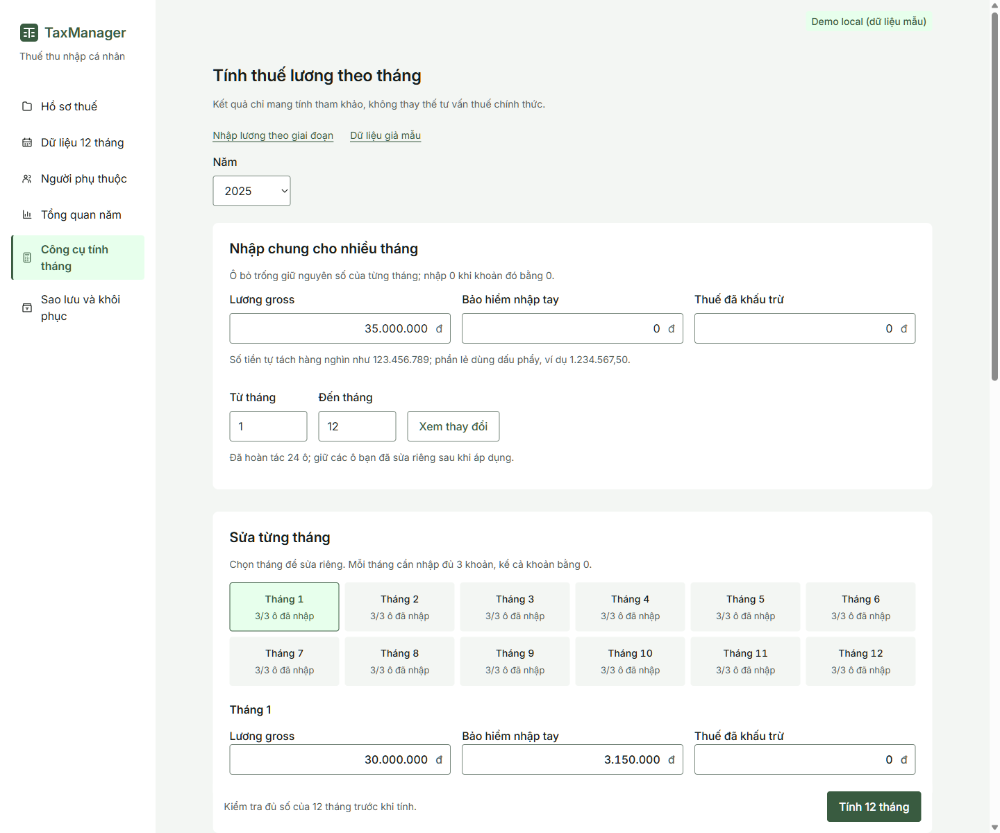

# TaxxManager

TaxManager là ứng dụng web tiếng Việt giúp cá nhân theo dõi lương, thưởng và ước tính thuế thu nhập cá nhân. Bạn có thể nhập mức lương cho cả một giai đoạn, điều chỉnh những tháng có thay đổi rồi xem kết quả theo tháng hoặc theo năm cùng các bước tính và căn cứ được sử dụng.

Đây là dự án cá nhân được xây dựng bằng C#/.NET, ASP.NET Core Razor Pages và SQLite. Phiên bản hiện tại là **bản thử chạy trên máy cá nhân và chỉ dùng dữ liệu giả**. Kết quả giúp tham khảo cách tính, không thay thế tư vấn thuế hoặc hồ sơ quyết toán chính thức.



*Màn tính thuế tháng với dữ liệu mẫu, chụp trong đợt kiểm tra giao diện ngày 28/11/2026.*

## Có thể làm gì?

- **Lập hồ sơ dự báo năm 2026.** Nhập lương theo giai đoạn, bổ sung thưởng tiền và bảo hiểm nhập tay, khai báo người phụ thuộc theo tháng hoặc giai đoạn.
- **Phân biệt số đã biết và số đang dự kiến.** Mỗi giá trị có thể giữ trạng thái thực tế, dự kiến hoặc giả định, kèm nguồn, ghi chú và thời điểm nhập. Ứng dụng phân biệt ô còn trống với khoản đã xác nhận bằng 0.
- **Đọc được cách tính.** Xem chi tiết từng tháng, nghĩa vụ thuế năm, bậc thuế và căn cứ. Mỗi lần tính năm tạo một kết quả lịch sử riêng để có thể xem lại sau này.
- **Thử thêm thưởng và đối chiếu số liệu.** So sánh kết quả khi thêm một khoản thưởng giả định, hoặc nhập số từ công ty hay eTax để đối chiếu theo chỉ tiêu và kỳ. Các phép thử này không thay đổi hồ sơ đã lưu.
- **Mang dữ liệu ra ngoài ứng dụng.** Xem báo cáo và danh sách cần kiểm tra, xuất CSV hoặc tạo bản sao lưu có mật khẩu. Khi khôi phục, ứng dụng mở một kho riêng để giữ nguyên kho ban đầu.
- **Thử luồng tài khoản.** Đăng ký và đăng nhập để dùng kho dữ liệu riêng. Chủ tài khoản có thể xuất JSON sau khi xác nhận lại mật khẩu.

Ngoài hồ sơ năm, ứng dụng có công cụ tính tháng riêng với bộ luật tham khảo cho năm 2025 và 2026. Giao diện hiện tập trung vào trường hợp có một nơi trả lương. Một số khả năng đã có trong thư viện Core chưa được đưa lên giao diện.

## Chạy trên máy

Các lệnh dưới đây dành cho Windows x64 và PowerShell. Bạn cần Git và SDK .NET **10.0.404** theo `global.json`. Nếu máy chưa có SDK phù hợp, làm theo [hướng dẫn thiết lập SDK](docs/decisions/0001-dev-setup.md) một lần trước khi chạy.

```powershell
git clone https://github.com/Md1507/taxxManager.git
cd taxxManager
.\run.ps1
```

Script tự chọn SDK, chuẩn bị môi trường, tải các gói phụ thuộc khi cần và chạy bản thử có tài khoản. Script ưu tiên SDK trong `.dotnet`, nếu không có thì dùng SDK đã cài trên máy theo `global.json`. Lần chạy đầu cần kết nối đến NuGet.

Nếu máy chưa tin cậy chứng chỉ HTTPS development, script sẽ hướng dẫn chạy lệnh sau. Bước này thường chỉ cần làm một lần và có thể hiện hộp thoại xác nhận của hệ điều hành:

```powershell
.\run.ps1 -TrustCertificate
```

Khi ứng dụng đã chạy, mở `https://localhost:5088/tai-khoan/dang-ky` để tạo tài khoản thử rồi đăng nhập. Những lần sau chỉ cần `.\run.ps1`. Ứng dụng dùng cổng 5088, vì vậy cổng này cần còn trống. Để dừng, nhấn **Ctrl+C** trong terminal đang chạy server.

### Thử nhanh không có tài khoản

Nếu chỉ muốn xem thử công cụ tính tháng và không cần luồng tài khoản, có thể chạy bằng HTTP mà không phải thiết lập chứng chỉ:

```powershell
.\run.ps1 -NoAccounts
```

Mở `http://127.0.0.1:5088/`, chọn **Dữ liệu giả mẫu** rồi **Tính 12 tháng** để xem cách ứng dụng hoạt động. Các trang tài khoản được ẩn trong chế độ này.

### Thử một hồ sơ năm

1. Mở `/Forecast`, tạo hồ sơ năm 2026 và nhập lương theo giai đoạn.
2. Bổ sung bảo hiểm, người phụ thuộc và thưởng nếu có. Nhập 0 khi xác nhận không phát sinh khoản đó, hoặc để trống nếu chưa biết.
3. Chọn **Lưu hồ sơ**, sau đó **Tính thuế năm**. Thiếu đầu vào bắt buộc sẽ hiện chỉ tiêu/tháng cần bổ sung.
4. Từ hồ sơ đã lưu, mở tổng quan, chi tiết tháng hoặc lịch sử. Bạn cũng có thể thử thêm thưởng giả định và đối chiếu với số liệu từ nguồn khác.

Khi đủ đầu vào bắt buộc, ứng dụng có thể tính nghĩa vụ thuế năm dù bạn chưa nhập đủ số thuế đã khấu trừ. Tuy nhiên, khi đó ứng dụng chưa xác định được chênh lệch nộp thêm hoặc nộp thừa. Nghĩa vụ năm được tính riêng theo bộ luật áp dụng, không lấy tổng thuế tháng để thay thế.

### Mở lại dữ liệu sau khi dừng

Khi kho dữ liệu được khởi tạo, terminal sẽ in dòng `Kho demo synthetic: ...` cùng đường dẫn của kho. Theo mặc định, mỗi lần chạy mới tạo một kho mới trong thư mục TEMP. Nếu muốn tiếp tục dùng dữ liệu cũ, giữ nguyên thư mục kho rồi truyền đường dẫn đó qua tham số `SyntheticStore`:

```powershell
.\run.ps1 -Store 'đường dẫn tuyệt đối của kho demo đã in trong terminal'
```

Ví dụ trên dành cho kho đã chạy với tài khoản. Nếu trước đó dùng chế độ không tài khoản, hãy thêm `-NoAccounts`. Dữ liệu trong kho demo chung không tự chuyển vào tài khoản mới.

Để mở lại được kho, cần giữ file khóa, marker và thư mục `accounts` nếu có. Nếu mở kho thất bại, hãy giữ nguyên các file để kiểm tra nguyên nhân thay vì tạo lại khóa.

Ứng dụng không tự xóa dữ liệu khi dừng, nhưng hệ điều hành có thể dọn thư mục TEMP. Nếu cần giữ bản thử lâu hơn, hãy tạo bản sao lưu có mật khẩu. Cách sao lưu và khôi phục được mô tả trong [hướng dẫn sử dụng Web](docs/web-mvp.md).

## Cấu trúc dự án

| Thư mục | Vai trò |
| --- | --- |
| `src/TaxManager.Core` | Mô hình nghiệp vụ, bộ luật theo kỳ và phép tính thuế. |
| `src/TaxManager.Data` | EF Core/SQLite, dữ liệu được bảo vệ, audit, lịch sử và hồ sơ dự báo. |
| `src/TaxManager.Web` | Giao diện Razor Pages, tài khoản local, báo cáo và sao lưu. |
| `tests/` | Các bộ kiểm thử Core, Data và Web. |
| `scripts/dev/` | Kích hoạt SDK và kiểm chứng toàn bộ Web MVP. |
| `docs/` | Thiết kế, quyết định kỹ thuật, lộ trình và bằng chứng kiểm chứng. |

## Kiểm tra khi phát triển

Việc chạy thử ứng dụng chỉ cần `run.ps1`. Khi phát triển và muốn kiểm chứng toàn bộ solution, chuẩn bị môi trường và restore theo [tài liệu phát triển](docs/development.md), rồi chạy:

```powershell
powershell -NoProfile -ExecutionPolicy RemoteSigned -File scripts/dev/verify-web-mvp.ps1
```

Script sẽ khôi phục công cụ .NET của repository, build solution và chạy cả ba bộ kiểm thử. Sau đó, script kiểm tra xem model EF có thay đổi nào chưa được ghi nhận bằng migration hay không. Các bước build và test dùng `--no-restore`, nên bạn cần restore solution trước lần chạy đầu.

Tài liệu phát triển cũng mô tả cách làm việc với database và khóa. Khi sửa mã, đọc `AGENTS.md` để giữ các quy ước của repository.

## Phạm vi hiện tại

Phiên bản hiện tại chỉ chạy trong môi trường **Development trên loopback** và chỉ dành cho dữ liệu giả. Luồng tài khoản local giúp thử việc đăng nhập và tách kho dữ liệu, nhưng chưa phải bản triển khai công khai dành cho dữ liệu thật.

Các căn cứ luật có trạng thái xác minh riêng. Một đường dẫn đến văn bản không có nghĩa là bộ luật đã được thẩm định đầy đủ. Bạn có thể xem phần còn thiếu trong [kiểm kê căn cứ pháp lý](docs/legal-source-status.md). Kết quả nộp thừa ước tính cũng không xác nhận quyền được hoàn thuế.

Giao diện chưa hỗ trợ nhiều nơi trả lương, đồng bộ eTax hoặc tự cập nhật luật bằng AI. Việc đối chiếu với nguồn bên ngoài hiện cần nhập số liệu bằng tay. Tài khoản local chưa có chức năng đặt lại mật khẩu khi quên, email, MFA hoặc xóa toàn bộ tài khoản.

Bản sao lưu thuế chứa kho thuế đang dùng và không bao gồm registry tài khoản. JSON và CSV xuất ra có thể đọc trực tiếp, còn gói sao lưu được bảo vệ bằng mật khẩu. Đây là những định dạng phục vụ các mục đích khác nhau.

Các bước tiếp theo và phần còn hoãn được theo dõi trong [lộ trình sản phẩm](docs/product-roadmap.md).

## Góp ý và báo lỗi

Bạn có thể gửi lỗi hoặc đề xuất qua [Issues của repository](https://github.com/Md1507/taxxManager/issues). Nếu gặp lỗi tính toán, hãy ghi rõ kỳ thuế, các bước tái hiện, bộ dữ liệu giả đã nhập và sự khác nhau giữa kết quả nhận được với kết quả mong đợi. Chỉ gửi dữ liệu giả để người khác có thể kiểm tra mà không cần tiếp cận thông tin cá nhân hoặc khóa thật.

## Giấy phép

Mã nguồn TaxManager được phát hành theo [giấy phép MIT](LICENSE). Bạn có thể sử dụng, sửa đổi và phân phối mã nguồn, kể cả cho mục đích thương mại, với điều kiện giữ thông báo bản quyền và nội dung giấy phép. Phần mềm được cung cấp theo hiện trạng, không kèm bảo đảm.

Phông chữ Inter đi kèm có giấy phép riêng là SIL Open Font License 1.1, được giữ trong [tệp OFL của phông chữ](src/TaxManager.Web/wwwroot/fonts/OFL.txt). MIT áp dụng cho mã nguồn dự án và không thay thế giấy phép của các tài nguyên, thư viện bên thứ ba.
