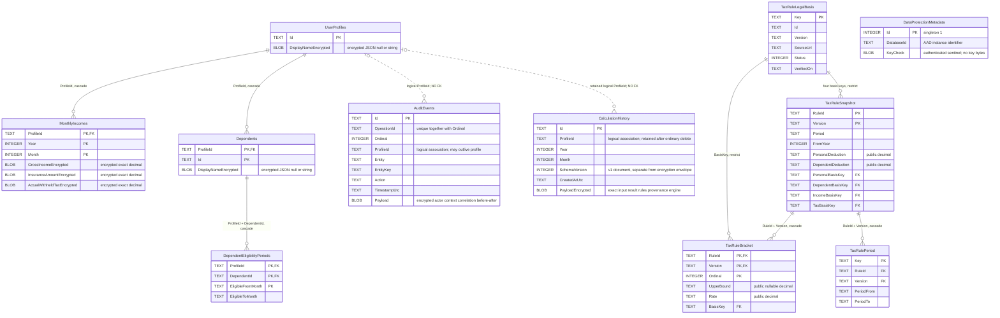

# Schema SQLite bước 2.4

Schema gồm bốn migrations; sáu tệp migration/designer của ba bước cũ giữ nguyên byte. Tên và ba khoản tiền cá nhân
chỉ có cột BLOB mã hóa, không còn cột plaintext legacy. Chỉ dùng dữ liệu giả cho tới
khi review độc lập và người dùng review bảo mật hoàn tất.

Mọi trường không ghi encrypted là metadata hoặc luật công khai plaintext. BLOB vẫn
lộ version/key ID/kích thước. Không có FK AuditEvents hoặc CalculationHistory → UserProfiles:
đường chấm chỉ liên kết logic, audit/history có thể tồn tại sau khi hồ sơ bị xóa. Metadata không chứa khóa;
khóa durable phải nằm ngoài source/repo và thư mục DB.

Hai trigger Period_NoOverlap_Insert/Update chặn khoảng chồng nhau cho cùng người
phụ thuộc; hai trigger TaxRulePeriod_NoOverlap_Insert/Update chặn kỳ luật chồng nhau
trên timeline chung. CHECK giữ giới hạn năm/tháng và khoảng tháng hợp lệ. Supported
writes/purge kiểm tra foreign keys đang bật, không chỉ dựa vào connection string.

Attach một principal Unchanged để tham chiếu hoặc thêm child không cập nhật parent
hay tạo audit cho parent. Setter sau Attach tạo write intent; chỉ các trường được
sửa lấy giá trị mới, các trường còn lại giữ giá trị DB. Đây là contract ứng dụng,
không thay đổi schema hoặc FK. Xem ADR0015 về detached Update và stale guards.

Xóa thông thường liệt kê cả children chưa load, ghi delete events rồi xóa graph trong
cùng transaction; audit và history mã hóa được giữ. Purge riêng xóa graph và mọi history/audit của target,
không lưu receipt liên kết target. Không cam kết xóa free pages/WAL/backups vật lý.

History có index (ProfileId, Year, Month, CreatedAtUtc), cho phép nhiều lần tính một kỳ;
CHECK year/month/schema. Không có FK tới nguồn income/dependent/rule có thể đổi.
Payload lưu input thực dùng, actual withheld riêng để đối soát, kết quả Core từng bước,
RuleId+Version/registration và căn cứ nguyên trạng, engine/build identity và UTC.
AAD xác thực mọi header; chỉ service tính từ dữ liệu đã lưu được append, supported
SaveChanges từ chối sửa/xóa trực tiếp. Đọc service luôn cần ProfileId+HistoryId;
đây không phải auth. Xem [ADR0016](decisions/0016-calculation-history.md).

Migrate DB legacy populated trực tiếp bị từ chối trước thay đổi schema. Upgrader
synthetic copy-forward tạo DB mới, đối chiếu toàn bộ dữ liệu/khóa/quan hệ/luật trước
publish. Sentinel được khởi tạo trong transaction import kể cả nguồn trống/chỉ có luật;
target công bố luôn kiểm tra khóa được khi reopen, không cần tạo hồ sơ giả.
Down của migrations 2.3 và 2.4 bị từ chối; rollback bằng matching backup/app.
Migration 2.3→2.4 chỉ thêm history/index, không rewrite dữ liệu/audit/luật/keys cũ.
Xem [ADR0015](decisions/0015-data-protection-audit.md) và [hướng dẫn phát triển](development.md).
