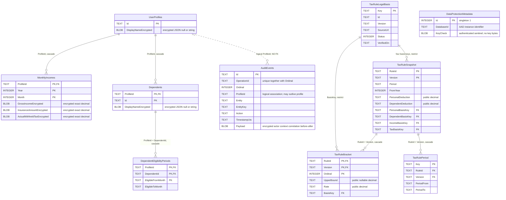

# Schema SQLite bước 2.3

Schema gồm ba migrations; hai migration cũ giữ nguyên. Tên và ba khoản tiền cá nhân
chỉ có cột BLOB mã hóa, không còn cột plaintext legacy. Chỉ dùng dữ liệu giả cho tới
khi review độc lập và người dùng review bảo mật hoàn tất.

Mọi trường không ghi encrypted là metadata hoặc luật công khai plaintext. BLOB vẫn
lộ version/key ID/kích thước. Không có FK AuditEvents → UserProfiles: đường chấm
chỉ liên kết logic, audit có thể tồn tại sau khi hồ sơ bị xóa. Metadata không chứa khóa;
khóa durable phải nằm ngoài source/repo và thư mục DB.

Hai trigger Period_NoOverlap_Insert/Update chặn khoảng chồng nhau cho cùng người
phụ thuộc; hai trigger TaxRulePeriod_NoOverlap_Insert/Update chặn kỳ luật chồng nhau
trên timeline chung. CHECK giữ giới hạn năm/tháng và khoảng tháng hợp lệ. Supported
writes/purge kiểm tra foreign keys đang bật, không chỉ dựa vào connection string.

Xóa thông thường liệt kê cả children chưa load, ghi delete events rồi xóa graph trong
cùng transaction; audit mã hóa được giữ. Purge riêng xóa graph và mọi audit của target,
không lưu receipt liên kết target. Không cam kết xóa free pages/WAL/backups vật lý.

Migrate DB legacy populated trực tiếp bị từ chối trước thay đổi schema. Upgrader
synthetic copy-forward tạo DB mới, đối chiếu toàn bộ dữ liệu/khóa/quan hệ/luật trước
publish. Down của migration 2.3 bị từ chối. Xem [ADR0015](decisions/0015-data-protection-audit.md)
và [hướng dẫn phát triển](development.md). Chưa có bảng lịch sử tính toán 2.4.
