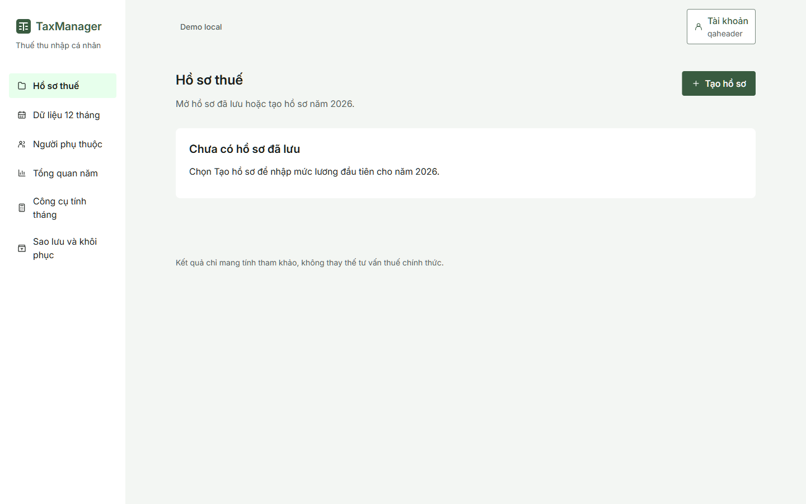
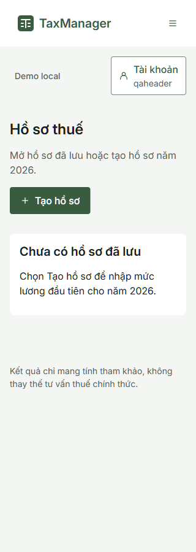
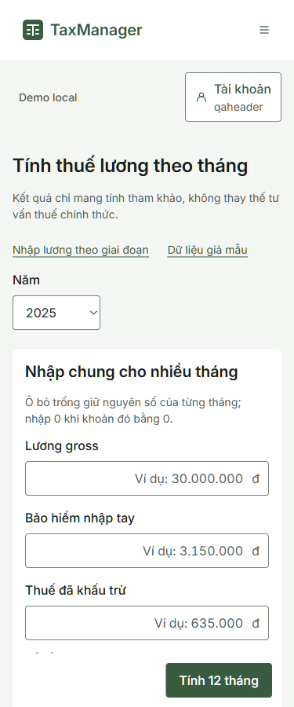
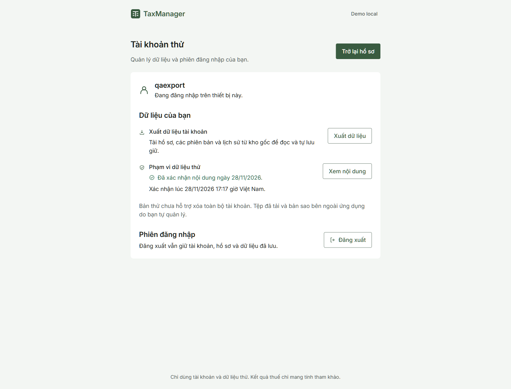
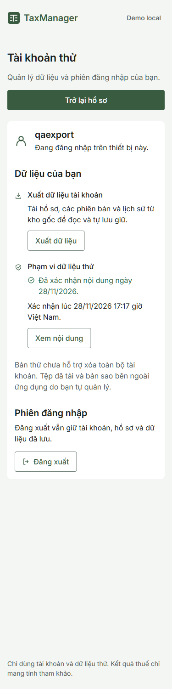
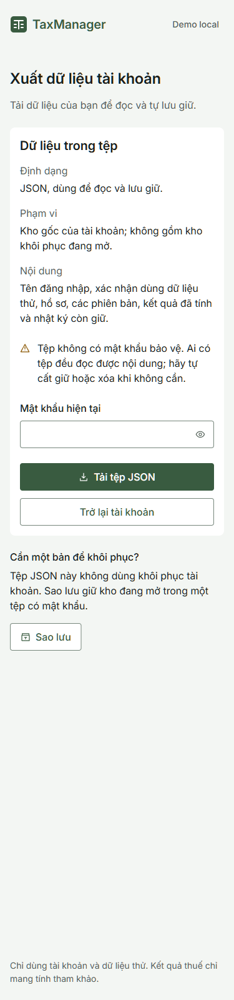
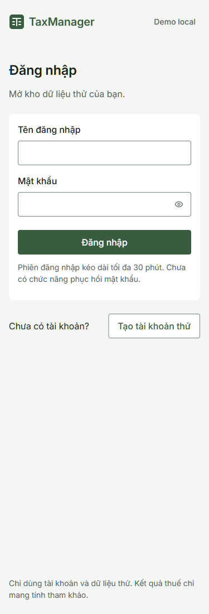
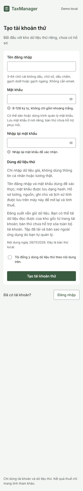

# Giao diện tài khoản — 28/11/2026

## Thay đổi

- Giữ Inter, xanh lục, nền xám pha xanh và panel trắng. Trang tài khoản rộng tối đa 46rem; logo, tiêu đề và nội dung cùng trục. Form đăng nhập/đăng ký giữ khổ hẹp hơn.
- Nhóm thông tin đăng nhập, dữ liệu và phiên đăng nhập bằng khoảng cách, không thêm đường phân chia hay thẻ lồng nhau. Mỗi hàng dữ liệu có SVG, tiêu đề, mô tả và nút phụ riêng; màn tổng quan có một nút đặc trở lại hồ sơ.
- Trạng thái xác nhận dùng chữ và icon, giữ ngày nội dung và thời điểm xác nhận thật. Đăng xuất có mô tả việc dữ liệu vẫn được giữ.
- Màn xuất JSON trình bày định dạng, phạm vi và nội dung bằng danh sách mô tả. Cảnh báo tệp đọc được nằm trước xác thực mật khẩu; nút chính “Tải tệp JSON” đứng trước nút quay lại trong DOM và trên mobile. Sao lưu để khôi phục là thao tác phụ riêng, giữ giải thích khác nhau giữa hai loại tệp.
- Đồng bộ nút chính toàn chiều rộng trong form đăng nhập/đăng ký và nút phụ chuyển giữa hai màn. Giữ kiểm tra mật khẩu trực tiếp 8–128 ký tự, nút hiện/ẩn, autocomplete, POST/CSRF, ReturnUrl và tất cả validation hiện có. Không sửa nội dung consent có phiên bản hoặc logic tài khoản/xuất dữ liệu.

## Kiểm chứng

- 35 test HTTP tài khoản/xuất dữ liệu/consent hiện có qua, gồm quyền truy cập, mật khẩu, CSRF và phạm vi kho gốc.
- Preview HTTPS 5094 được mở lại bằng cùng kho synthetic, tài khoản thử vẫn đăng nhập và mở được màn tài khoản/xuất dữ liệu. Không thay tiến trình riêng 5088.
- Orca từ chối chứng chỉ HTTPS local. Ảnh và axe chạy trên mirror của phản hồi HTML thật từ HTTPS 5094; form mirror vô hiệu hóa submit. Đây là kiểm tra trình bày, không phải bằng chứng luồng đăng nhập browser HTTPS. Hành vi server được kiểm qua HTTP tests và request HTTPS tới preview.
- Kiểm nội dung tiếng Việt tại 320/375 và 1440 px. Màn tài khoản, đăng nhập/đăng ký không tràn ngang; màn tài khoản 375, đăng nhập 320 và đăng ký 320: axe 0 violations/0 incomplete. Màn xuất cũng có một primary và axe 0 violations/0 incomplete. Ảnh toàn nội dung được chụp bằng viewport cao để thấy cả nút cuối và footer.
- Sloplint đã chạy với `--scope app --genre modern-minimal --render`: 0 WARN, một phát hiện chung gate 56 về sidebar và thead sticky top:0 thuộc các vùng cuộn riêng. Các trang tài khoản không có hai thành phần này. Render tier không chạy do thiếu puppeteer-core; dùng ảnh Orca làm bằng chứng riêng. Không báo linter sạch.
- Finish review Hallmark độc lập yêu cầu chụp lại ảnh đầy đủ trước khi đánh giá; sau ảnh mới 1440/375 và toàn bộ Export/Register/Login, kết luận `ship`, không có phát hiện visual đáng kể. Giữ nguyên hệ xanh và nội dung consent có phiên bản.
- `bint test affected --run` không chạy vì full scope thiếu `eval.test_command`. JSON widening cuối chỉ ra ảnh báo cáo, `.hallmark/log.json`, `.hallmark/preflight.json` và `run.ps1` (tệp của phiên khác) chưa được ánh xạ. Theo [k:01M8F671GP7FD4E6G4CVEW6E7R], không thay cấu hình hoặc thu hẹp cổng.
- Script Web MVP cuối thoát 0: Core 209, Data 332, Web 191, tổng 732 test; EF không có pending model changes. `git diff --check` qua. Không sửa test, migration hoặc service để phục vụ lượt thiết kế.

## Bổ sung: lối vào tài khoản trên trang chính

- Link chữ trần trên topbar đổi thành nút phụ có icon tài khoản, nhãn “Tài khoản” và tên đang đăng nhập. Đích vẫn là `/tai-khoan`, không có dropdown hoặc mũi tên. Dùng anchor cho thao tác điều hướng và giữ hành vi bàn phím/mở tab mới.
- “Demo local” nằm riêng bên trái; nút tài khoản nằm bên phải, dùng màu và viền của nút phụ để không cạnh tranh với primary của màn đang mở. Tên dài giới hạn chiều rộng và ellipsis, tên đầy đủ vẫn nằm trong accessible name và title.
- Kiểm phản hồi HTTPS đã đăng nhập trên Hồ sơ, công cụ tính tháng và Forecast. Browser dùng mirror HTML thật, form vô hiệu hóa submit như ở trên. 320/375/1440 px không tràn ngang; nút tài khoản cao 63 px; tên synthetic 64 ký tự vẫn nằm trong nút. Hồ sơ 320: axe 0 violations/0 incomplete, đúng một primary.
- Bản kiểm tra mới chạy đầy đủ tài khoản trên HTTPS 5095 với kho synthetic riêng; không thay kho hoặc tiến trình cũ ở 5094/5088. Không dùng mirror 5092 làm ứng dụng vận hành.
- Sloplint ở scope component: static 0 FAIL/REFLEX/WARN; render tier không chạy do thiếu puppeteer-core. Kiểm ảnh Orca riêng.
- Finish review độc lập cho component kết luận `ship`, không có phát hiện; giữ nút phụ duy nhất, icon và tên truy cập rõ. Không đổi điều hướng fragment/scroll spy của Forecast [k:01M8G447XSG9YDAZ5Y8QZDZJ97].
- Kiểm chứng sau chỉnh topbar: Web MVP thoát 0, Core 209/Data 332/Web 191 (732 test), EF không pending model changes. Affected test vẫn không chạy do full scope thiếu eval.test_command; đã đọc widening, giữ ảnh và cấu hình [k:01M8F671GP7FD4E6G4CVEW6E7R].

## Ảnh các màn tài khoản

