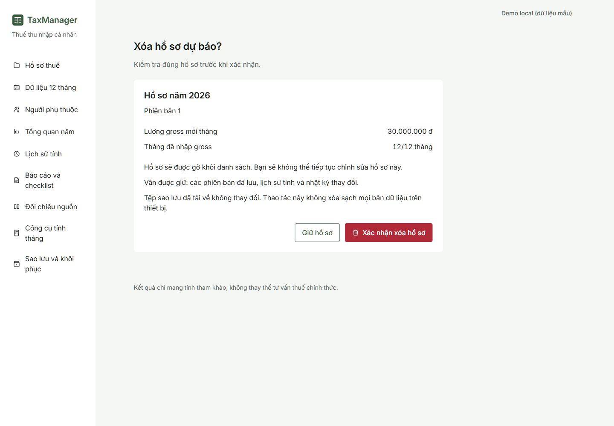
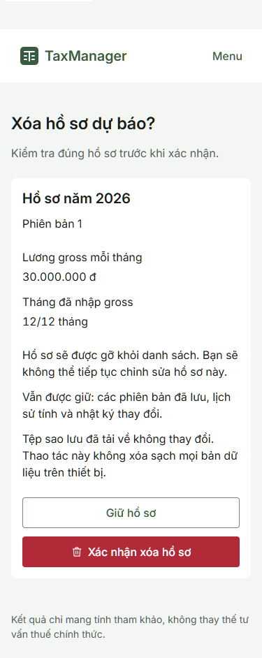
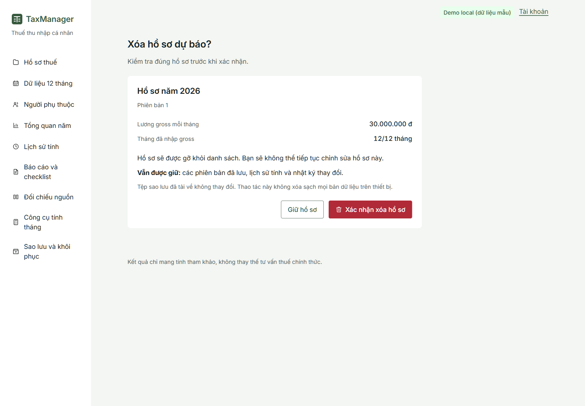
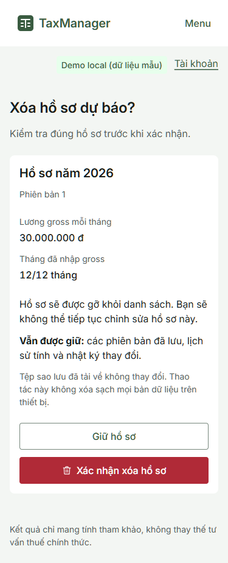
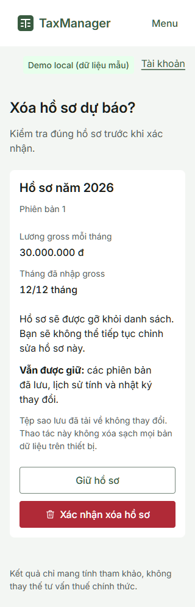

# Xác nhận xóa hồ sơ — 28/11/2026

## Hiệu chỉnh typography theo phản hồi

Ảnh người dùng cho thấy nhãn, số liệu và mô tả thay đổi cỡ/đậm/màu quá nhiều trong cùng panel. Lượt hiệu chỉnh chỉ thêm CSS giới hạn ở `.delete-confirmation`: tiêu đề 20 px/600; phiên bản, nhãn, số liệu và mọi đoạn giải thích cùng 16 px/400, màu `--text`. Bỏ nhấn đậm riêng cụm “Vẫn được giữ”. Không thay logic hay nội dung. H1 màn giữ 24 px và nút giữ weight 500 theo hệ chung.

Đã kiểm computed style trên app HTTP thật: tất cả nội dung nêu trên đều 16 px/400, rgb(26,31,27); tiêu đề 20 px/600. Ảnh 320/375/1440 px không tràn ngang, đã xem trực tiếp. Axe trên mirror phản hồi HTTPS: 0 violations, 0 incomplete. Full account preview HTTPS 5094 phục vụ CSS mới; cùng kho và tiến trình, không cần khởi động lại.

Hallmark polish trong phiên: kiểm lại phân cấp, wrap và số liệu, không thêm phát hiện; static vẫn có gate 56 dùng chung không áp dụng cho trang không có bảng, 0 WARN; render tier thiếu puppeteer-core. Quy tắc typography đã bổ sung vào UI_UX_PLAN mục 15.10.

Cổng sau chỉnh typography: `verify-web-mvp.ps1` qua 725 test (209 Core, 332 Data, 184 Web) và EF không có thay đổi model chờ migration.

## Thay đổi

Áp dụng frontend-design, UI UX Pro Max và Hallmark theo hệ giao diện đã chốt: Inter, xanh lục, nền xám pha xanh, một panel trắng có chiều rộng giới hạn. Màn xác nhận hiển thị năm, phiên bản thực đã lưu, khoảng gross và số tháng có dữ liệu; UUID chỉ còn trong trường ẩn. Không thêm dropdown, đường phân chia hay thẻ meta.

Hậu quả xóa nằm ngay trước hành động; giải thích phiên bản, lịch sử tính, nhật ký và bản sao lưu bằng tiếng Việt thông thường. “Giữ hồ sơ” là nút phụ; “Xác nhận xóa hồ sơ” là nút đặc đỏ duy nhất có icon thùng rác. Mobile xếp nút dọc, vùng chạm 44 px. Paragraph dùng `text-wrap: pretty`, vẫn đọc được trên trình duyệt không hỗ trợ.

GET đọc hồ sơ thực thay vì hiển thị Revision từ query. GET thiếu/0 giải quyết thành phiên bản hiện tại và bỏ giá trị ModelState cũ. POST giữ nguyên optimistic concurrency: phiên bản cũ hoặc 0 bị chặn. Hồ sơ không còn tồn tại trả 404, không có form xóa. GET không ghi dữ liệu. Thiếu gross khác 0 [k:01M8BMXR829S6QRCBBJWYSB8SF]; ordinary delete giữ lịch sử/nhật ký [k:01M85QH0MMV8Y56ZK918ZB7QBV].

## Kiểm chứng

- Bốn ca HTTP mới: GET thiếu/0, dữ liệu thực và UUID ẩn; GET/POST stale, CSRF, hủy, xóa mới nhất và giữ phiên bản; hồ sơ không tồn tại. Không sửa test đóng băng.
- HTTP thật trên bản preview đầy đủ HTTPS 5094: mở lại tài khoản synthetic có sẵn, lưu hồ sơ QA, đọc xác nhận xóa. Giữ cùng kho synthetic sau khi khởi động lại preview.
- Orca không chấp nhận chứng chỉ HTTPS local. Ảnh bên dưới là HTML phản hồi thực từ HTTPS, phục vụ qua mirror 5092 với form vô hiệu hóa để kiểm thị giác; không gọi mirror là app đầy đủ. Tương tác bàn phím và hủy kiểm trên app synthetic HTTP 5093, bằng hồ sơ QA riêng.
- 320/375/1440 px: không tràn ngang, một primary, nút không xuống dòng. Axe WCAG 2 A/AA, 2.1 A/AA, 2.2 AA trên mirror: 0 violations, 0 incomplete. Kiểm bằng mắt cả ba ảnh.
- Hallmark finish review bằng agent riêng: một phát hiện xuống dòng cuối đoạn tại 375 px; thêm `text-wrap: pretty` và chụp lại, đã giải quyết. Không có ảnh trước được lưu nên không chấm so sánh trước/sau.
- `sloplint --scope app --genre modern-minimal --render`: lần cuối static báo 1 FAIL gate 56 trên CSS dùng chung (`sidebar` và `thead th`), 0 WARN. Trang xóa không có bảng nên phát hiện này không áp dụng; không sửa sticky sidebar của màn khác. Render tier không chạy vì thiếu puppeteer-core; ảnh Orca và axe là bằng chứng riêng, không ghi lint clean.
- `bint test affected --run` không chạy test: bgraph yêu cầu full nhưng `eval.test_command` chưa cấu hình. Đã đọc JSON selection.widening: ảnh báo cáo ngoài project cùng các tệp chưa được ánh xạ làm nới full [k:01M8F671GP7FD4E6G4CVEW6E7R]. Thay bằng `scripts/dev/verify-web-mvp.ps1`: mã thoát 0; Core 209, Data 332, Web 184 (tổng 725), EF không có pending model changes. Lượt đầu có một lỗi câu chữ trong test đóng băng, đã sửa UI để giữ nghĩa lịch sử và nhật ký; không đổi assertion.
- Quy tắc GET/POST revision được ghi bằng CLI Bint, origin agent, trạng thái candidate `01M8GW2K48WQJBXPBJ2HK0ZFA5`; chưa duyệt hay publish.

## Ảnh bản cuối

