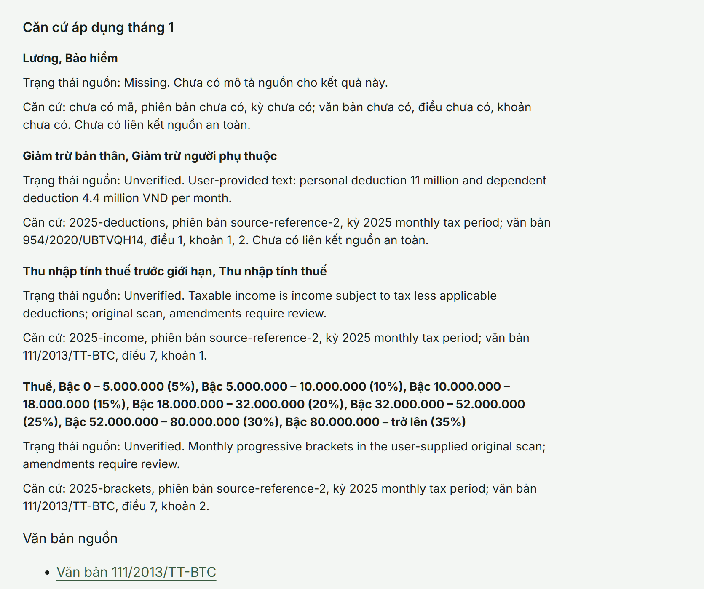
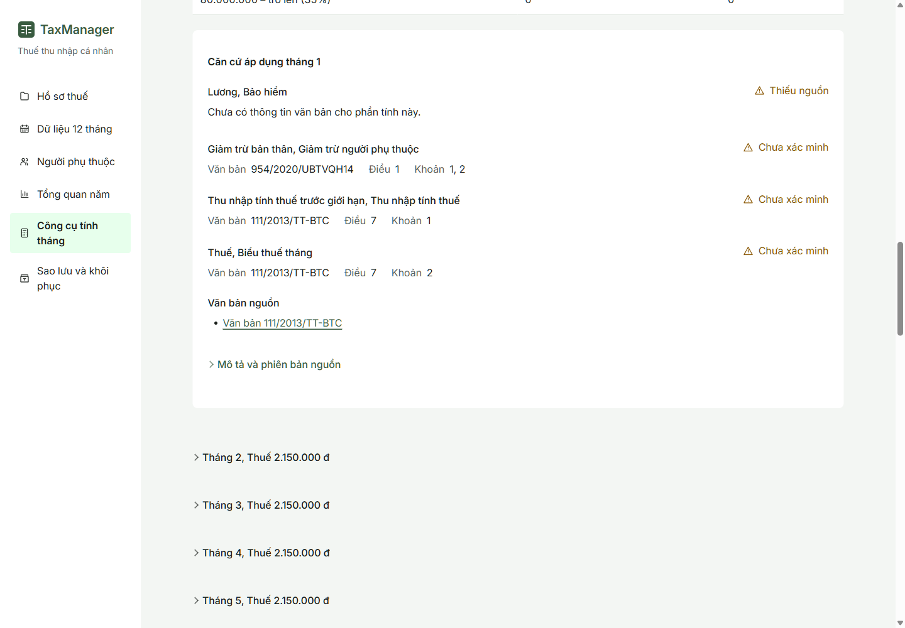
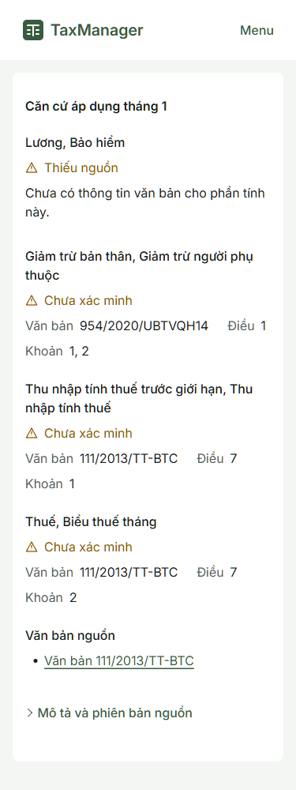

# Căn cứ áp dụng tháng — 28/11/2026

Theo ảnh người dùng, phần căn cứ cũ lặp các đoạn dài: trạng thái bằng enum tiếng Anh, mô tả gốc, trường thiếu và toàn bộ bậc thuế ghép vào tiêu đề đậm. Lượt này thay cách trình bày trên trang tính tháng `/`, giữ nguyên dữ liệu luật và kết quả tính.

## Bản mới

- Một panel chung, danh sách nhóm theo `LegalBasis` đầy đủ. Mỗi nhóm có tên, trạng thái chữ Việt kèm SVG và màu; không dùng màu làm dấu hiệu duy nhất. Thiếu nguồn/Chưa xác minh dùng token warning, Đã xác minh dùng success. Enum gốc giữ trong data attribute và snapshot; không nâng mức xác minh.
- Văn bản, điều, khoản, điểm hiển thị ngay thành nhãn–giá trị. Trường không có không sinh chuỗi “chưa có” liên tiếp. Nhóm không có citation có một câu báo thiếu.
- Phần bậc thuế giữ bảng chi tiết đã có ngay phía trên. Phần căn cứ chỉ dùng heading “Biểu thuế tháng”, không nối bảy khoảng thu nhập vào heading. Các căn cứ khác nhau ở từng bậc vẫn là các nhóm riêng, Label chi tiết trong provenance giữ khoảng thu nhập/thuế suất của các bậc ứng với từng căn cứ. Heading ngắn tách khỏi Label để không mất ánh xạ này khi rút gọn.
- Một disclosure native “Mô tả và phiên bản nguồn” cho mỗi tháng. Mô tả gốc, mã nguồn, phiên bản, kỳ, ngày hiệu lực và ngày xác minh vẫn truy cập được. Không dịch hoặc diễn giải lại nội dung pháp lý. Có thể mở bằng Enter khi focus ở summary, không phụ thuộc JavaScript.
- Liên kết nguồn tiếp tục gom theo URL an toàn tại một vị trí chung; căn cứ cùng URL nhưng khác khoản vẫn tách nhóm. Razor tiếp tục encode toàn bộ metadata.
- Chữ nội dung 16 px cùng thang token, tên nhóm weight 500. Dùng khoảng cách để phân nhóm, không thêm đường kẻ hay card cho từng căn cứ.

## Kiểm chứng

- 8 ca focused cuối đã qua (`CitationTests` và `MonthlySalary.GetTests`). Giữ các kiểm tra status, escape script, từ chối javascript URL, metadata khác khoản và URL không lặp; bổ sung kiểm trạng thái tiếng Việt, phần tra cứu chung, nhãn biểu thuế ngắn và giữ mô tả gốc. Ca HTTP tách nguồn riêng của bậc đầu kiểm provenance giữ đúng khoảng/thuế suất và không đưa khoảng dài vào heading bên ngoài.
- Orca trên app thật HTTP 5093: nhập chung 12 tháng, áp dụng, tính, mở tháng 1; chụp 320/375/1440 px, kiểm không tràn ngang. Phần tra cứu ban đầu đóng, Enter mở và Enter đóng; mã phiên bản gốc vẫn có. Axe WCAG 2 A/AA, 2.1 A/AA, 2.2 AA: 0 violations, 0 incomplete.
- HTTP thật trên HTTPS 5094 có tài khoản: đăng nhập lại tài khoản synthetic có sẵn, tính 12 tháng, nhận đủ 12 section căn cứ và provenance. Giữ nguyên kho synthetic của bản preview. Browser không được bỏ qua lỗi chứng chỉ HTTPS local; ảnh và tương tác là trên HTTP synthetic.
- Hallmark finish review trong ngữ cảnh riêng: `ship`, không phát hiện cần sửa; xác nhận rõ ở 320/375/1440 và còn đủ provenance. Trước/sau đối chiếu với ảnh người dùng.
- Sloplint static vẫn báo gate 56 trên sidebar và thead dùng chung; sidebar đứng cạnh nội dung, header bảng cuộn riêng nên không phải hai banner chồng nhau. 0 WARN. Render tier không chạy vì thiếu puppeteer-core; Orca/axe là bằng chứng riêng, không tuyên bố lint clean.
- `bint test affected --run` không chạy test vì scope nới full mà `eval.test_command` chưa cấu hình. Đã đọc JSON selection.widening: ảnh và tệp chưa được bgraph ánh xạ làm nới full [k:01M8F671GP7FD4E6G4CVEW6E7R]. `verify-web-mvp.ps1` cuối mã thoát 0: Core 209, Data 332, Web 185 (tổng 726); EF không có model changes chờ migration. Không sửa cấu hình Bint để vượt cổng.
- Bint knowledge `01M8GX0100E5RQET2R4843H8R3` ghi lưu ý giữ ánh xạ bậc trong provenance: origin agent, candidate, chưa duyệt/publish.

## Ảnh

