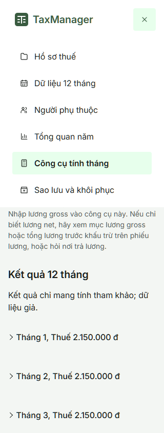
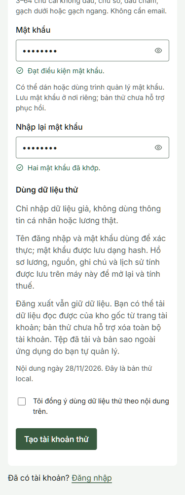

# Mật khẩu trực tiếp và menu mobile — 28/11/2026

## Thay đổi

- Theo yêu cầu, min mật khẩu tài khoản từ 12 xuống 8, max 128 giữ nguyên: Identity RequiredLength, validation PageModel, thuộc tính HTML và thông báo trực tiếp cùng một hợp đồng. Không thêm yêu cầu chữ hoa/số/ký tự đặc biệt. Không thay chính sách sao lưu hoặc áp min vào việc xác thực mật khẩu tài khoản đã có.
- Form đăng ký hiển thị điều kiện và khớp nhập lại bằng chữ + SVG + token màu; ban đầu trung tính, chưa đạt màu warning, đạt màu success. JS đọc min/max từ input. Đổi một trong hai ô tính lại cả hai trạng thái, nhận input/change/pageshow cho paste/autofill. Không trim mật khẩu. Kiểm whitespace theo tập ký tự của .NET Required, không dùng quy tắc khác nhau giữa hai phía.
- Aria-live polite/atomic chỉ thay nội dung khi thông điệp đổi, không đọc số đếm mỗi phím hay giá trị mật khẩu. Không gửi request kiểm mật khẩu, không lưu giá trị. Nút hiện/ẩn, paste và trình quản lý mật khẩu vẫn dùng được. Native required/minlength/maxlength và custom validity chặn điều kiện chưa đạt; server kiểm độc lập khi tắt JS. Nút gửi vẫn khả dụng.
- Lỗi nút “Tính 12 tháng” nằm trong menu là do sidebar và form-actions cùng layer 20, phần nội dung xuất hiện sau thắng thứ tự vẽ. `.workspace` tạo stacking context ở layer base, toàn bộ thanh hành động/header bảng bị giữ bên dưới sidebar. Không tăng z-index vô hạn hay tắt sticky của form.
- Nút menu đổi thành icon menu/đóng, có aria-label, title, expanded state và nhãn ẩn, hit target 44 px; không còn chữ “Đóng menu” xuống dòng ép logo.

## Kiểm chứng

- 7 focused test qua, gồm 6 ca HTTP không JS: 7 ký tự từ chối, 8 và 128 chấp nhận, 129 từ chối, toàn khoảng trắng từ chối, nhập lại sai từ chối. Kiểm tài khoản chỉ thực sự tạo ở ca hợp lệ và POST lỗi không echo bí mật. Giữ test CSRF/duplicate/không echo có sẵn.
- Preview cập nhật cùng kho synthetic và chế độ tài khoản HTTPS 5094. Không thay app riêng đang chạy ở 5088.
- Do Orca từ chối chứng chỉ HTTPS local, kiểm trực tiếp JS form trên mirror phản hồi GET thật của HTTPS, form mirror vô hiệu hóa submit. Đã thử gõ/fill 7 rồi 8 ký tự, khớp rồi đổi mật khẩu chính; thêm các ca rỗng, khoảng trắng, 128 và 129 bằng input events, không lộ giá trị trong báo cáo. Trạng thái và native validity đúng; trạng thái khớp chỉ nói về việc hai giá trị bằng nhau, vẫn cần điều kiện mật khẩu riêng đạt.
- Menu kiểm trên app HTTP thật: tính 12 tháng synthetic, cuộn để bar ở khoảng y=180, mở menu, cuộn lại đúng điểm chồng lấp. `elementFromPoint` tại tâm nút tính trả về link bên trong navigation ở 320 và 375 px; không phải nút tính. Ảnh xác nhận nút không còn xen vào danh sách. Desktop 1440 giữ sidebar sticky; nút menu ẩn. Không overflow ngang.
- Axe WCAG 2 A/AA, 2.1 A/AA, 2.2 AA: form mirror 0 violations/0 incomplete. Menu trên app thật: 0 violations, 1 incomplete color-contrast do phần nội dung đang bị menu phủ; không coi incomplete là pass tương phản tự động. Chữ menu dùng token text/surface và text/brand-tint đã chốt; đã xem ảnh trực tiếp. Node syntax check JS qua.
- Hallmark polish theo hệ Inter/xanh đã chốt: không đổi bố cục form; không thêm thang điểm sức mạnh giả hoặc chip thừa. Sloplint static 1 gate 56 chung do sidebar và thead có top:0 nhưng không cùng vùng cuộn, 0 WARN; render tier không chạy do thiếu puppeteer-core. Dùng Orca captures và hit-test làm bằng chứng riêng.
- `bint test affected --run` không chạy vì full scope thiếu eval.test_command; đã đọc JSON widening với ảnh/tệp chưa được ánh xạ [k:01M8F671GP7FD4E6G4CVEW6E7R]. Web MVP script cuối thoát 0: Core 209, Data 332, Web 191 (tổng 732), EF không có pending model changes. Không thay cấu hình hay thu hẹp test để bỏ qua cổng.

## Ảnh

