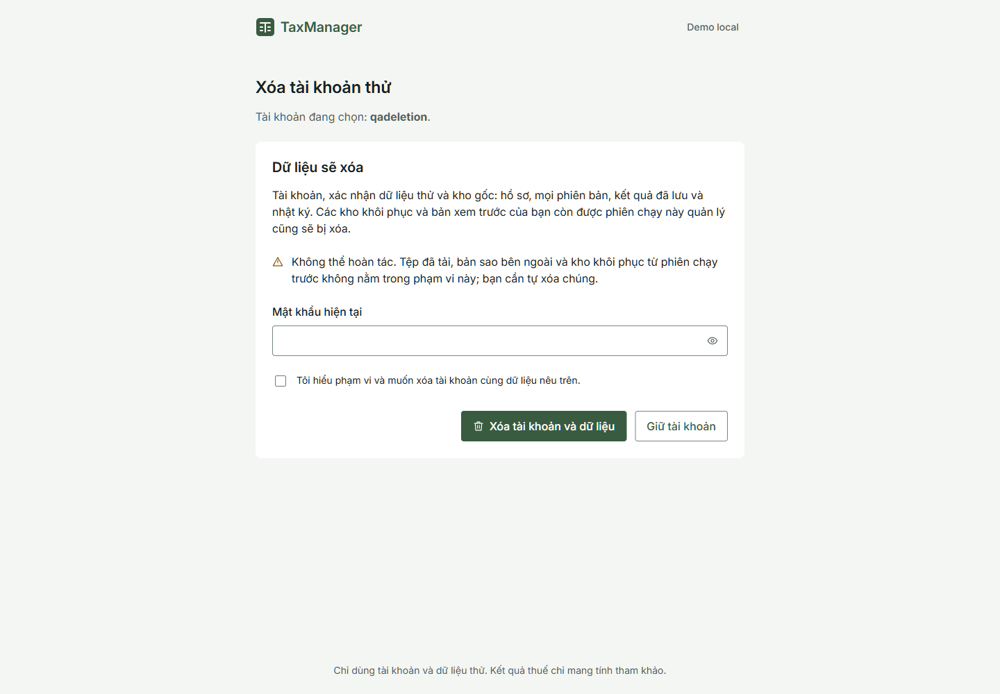
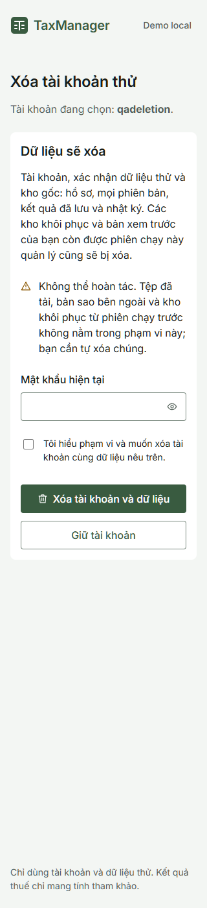
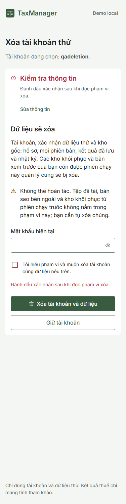

# Đ6d — xóa tài khoản thử

## Kết quả và phạm vi

Đã triển khai `/tai-khoan/xoa`, nối từ mục tài khoản. GET chỉ hiện xác nhận; POST cần mật khẩu hiện tại, checkbox và CSRF đúng subject. Sau thành công đăng xuất, các browser khác không còn dùng được tài khoản cũ. Có thể đăng ký lại cùng tên với subject/kho mới. Không dùng nút giả hoặc hyperlink nhắc lại thao tác.

Xóa Identity/claims, kho gốc (gồm các phiên bản, snapshot và audit), restored/preview của chủ còn được host quản lý. Phạm vi được nói trước khi gửi form. Tệp đã tải, bản sao bên ngoài, kho khôi phục từ phiên trước không còn gắn chủ và bảo đảm xóa vật lý khỏi ổ đĩa nằm ngoài phạm vi này. Chỉ dùng local synthetic, chưa nghiệm thu quyền dữ liệu thật hoặc vận hành mạng.

## Tính nhất quán

- Gate theo tài khoản bao quanh request xác thực, ngoài gate workspace theo browser. Sau khi chờ phải kiểm lại user trong registry; tránh tab đang chờ đọc kho sau khi tài khoản đã xóa.
- Ghi manifest vào claim Identity trước thao tác filesystem; manifest chứa subject/kho gốc và các root do server chọn. Preflight xác minh TEMP/name/marker/không links và không trùng shared root hoặc kho gốc user khác. Không nhận đường dẫn/chủ từ form; không cần giải mã để xóa kho hỏng khóa.
- Khi pending, chặn data/exports; chỉ tiếp tục xóa hoặc đăng xuất. Dispose và gỡ cache/preview/restored của chủ, xóa các root trong manifest, cuối cùng mới xóa Identity. Lỗi giữ intent để thử lại với host mới, không khởi tạo lại kho đã mất. Không sửa migration hay lịch sử bằng cách xóa entity riêng lẻ.
- Thông báo dữ liệu thử lên `local-demo-2026-11-29-v3`, giữ claim cũ và yêu cầu xác nhận phiên bản mới trước route dữ liệu. Người chưa xác nhận vẫn có quyền xuất/xóa. Hai ca dữ liệu claim sai/future ở phiên bản hiện tại bổ sung vào test có sẵn, giữ ca v2 lịch sử.

## Kiểm chứng

- 9 ca HTTP mới ban đầu qua: anonymous/GET/CSRF/password/checkbox; A/B và giả UserId/StoreRoot; lịch sử năm và claims; cookie browser khác; tài khoản cũ chưa xác nhận với khóa mất; lockout; root shared/khác chủ/ngoài phạm vi; lỗi ghi manifest; lỗi xóa Identity sau khi tệp đã mất và thử lại với host mới; restored đang mở và preview qua nhiều browser; request đã xác thực chờ gate. Một test có thể kiểm nhiều bất biến liên quan trong cùng luồng.
- Web MVP đầy đủ thoát 0: Core 209, Data 332, Web 202, tổng 743 test; EF không có pending model changes. Có hai warning xUnit2031 hiện có trong `ForecastPersistenceBlackBoxTests.cs` dòng 241/243, không sửa tệp đó trong lượt này; không báo build sạch warning.
- Bổ sung hai ca riêng cho form xóa A gửi sau khi chuyển sang B và hai POST xóa đồng thời. Lượt build bổ sung bị MSB3027 do testhost cổng đầy đủ giữ DLL; chạy lại tuần tự sau khi cổng kết thúc: toàn bộ 11 ca xóa qua, không skip. Không dừng tiến trình phiên khác hoặc làm yếu kiểm thử. Hai ca bổ sung này chạy sau cổng 743 test, không cộng lặp 9 ca đã nằm trong cổng.
- `bint test affected --run` không chạy được: full scope thiếu eval.test_command, JSON widening có các tệp/ảnh audit Hallmark chưa ánh xạ. Giữ các tệp phiên khác và chạy script đầy đủ theo [k:01M8F671GP7FD4E6G4CVEW6E7R].
- Bằng chứng host mới dùng đúng root registry cũ trong test, không nhầm client mới với host mới [k:01M8CBFTQHZAEP0A2M9H7GWSHN]. Tri thức về manifest/gate đã ghi candidate `01M8HKAS4NGKW7Q9S68RNX6TYQ`, chưa duyệt/publish.

## Giao diện

Giữ xanh/Inter và layout tài khoản; một primary, một nút phụ giữ tài khoản, cảnh báo icon/chữ trước trường mật khẩu, checkbox chưa chọn. Không thêm divider/dropdown/card lồng nhau. Khi pending thay hành động phụ bằng đăng xuất vì không thể hủy phần tệp đã xóa.

Preview tài khoản HTTPS 5097 chạy kho synthetic mới, không sửa dữ liệu các preview cũ. Do Orca từ chối chứng chỉ local, browser QA dùng mirror phản hồi HTML thật từ HTTPS, form mirror vô hiệu hóa submit. Kiểm GET và POST thiếu checkbox trên HTTPS thật; các POST xóa thật được kiểm bằng test synthetic. Không gọi mirror là luồng HTTPS trong browser.

Ảnh 1440/320, lỗi 375; không tràn ngang, có đủ nút cuối form. Axe form thường 320 và lỗi 375: 0 violations/0 incomplete. Checkbox lỗi có aria-invalid, liên kết sửa tới đúng ConfirmDeletion, summary nhận focus; mật khẩu không echo. Hallmark finish review độc lập: `ship`, không có phát hiện visual. Sloplint có một FAIL chung gate 56 của sidebar/theader sticky khác vùng cuộn, ngoài các màn tài khoản; render tier không chạy vì thiếu puppeteer-core. Không báo linter sạch, dùng ảnh Orca làm bằng chứng riêng.

