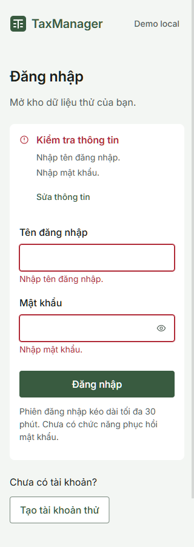

# Đ6f — kiểm thao tác form tài khoản

Ngày 29/11/2026. Kiểm các màn đã triển khai, giữ palette, Inter, bố cục và nội dung hiện có. Không bắt đầu bản redesign đang chờ duyệt. Áp dụng UI/UX Pro Max, Web Interface Guidelines và Orca browser.

## Thay đổi

`FieldErrorTagHelper` đã tự nối ID lỗi và `aria-invalid` khi server từ chối dữ liệu. Các ô có sẵn ID lỗi trong `aria-describedby` (đồng ý dùng dữ liệu thử, xuất, xóa) bị nối cùng ID lần nữa. Chỉ nối khi danh sách chưa có ID đó; giữ nguyên hướng dẫn và lỗi. Không đổi PageModel, dữ liệu gửi, validation hay CSS.

Lượt đầu đã thêm ID lỗi vào template login/register do chưa đọc helper chung; đã gỡ hoàn toàn phần bổ sung dư đó trước kiểm chứng cuối. Không ghi nhận chúng là tính năng mới.

## Bằng chứng kiểm tra

- Bản thử mới HTTPS 5099 dùng kho synthetic riêng; không sửa các preview cũ. GET và POST lỗi thật lấy từ HTTPS; có tạo/đăng nhập tài khoản synthetic `qaux` để lấy các màn tài khoản, phạm vi, xuất và xóa. Không gửi xuất/xóa thành công trong browser QA này.
- Orca từ chối chứng chỉ local. QA browser dùng HTML phản hồi thật trên mirror HTTP 5098 với submit vô hiệu hóa. Không coi đây là nghiệm thu vòng đăng ký/đăng nhập qua trình duyệt HTTPS. Các POST và ranh giới dữ liệu được kiểm bằng bộ HTTP hiện có.
- 8 trạng thái × 2 chiều rộng 320/1280 = 16 lượt: login, login thiếu trường, register, register lỗi server, tài khoản, xuất, xóa, thông báo đã xác nhận. Axe WCAG 2 A/AA, 2.1 AA, 2.2 AA: 0 violations, 0 incomplete; không tràn ngang, một primary mỗi màn. Kết quả máy tại `2026-11-29-account-ux-checks.json`. Không gọi kết quả này là chứng nhận accessibility toàn bộ.
- HTML sau sửa không có ID mô tả lỗi trùng trong 16 lượt; lỗi đăng nhập/đăng ký giữ `aria-invalid` và mật khẩu rỗng sau POST lỗi. Form lỗi nhận focus summary, Tab rồi Enter trên “Sửa thông tin” tới `Username` trong vùng nhìn thấy.
- Nhập 8 ký tự bằng thao tác type: điều kiện báo đạt. Tab tới nút mắt, Enter đổi password → text, `aria-pressed=true` và tên “Ẩn mật khẩu”; Enter lần nữa ẩn lại; Tab tới xác nhận, nhập cùng giá trị thì báo khớp. Nút mắt 44 × 44 px.
- Không có handler chặn paste trong mã. Probe ClipboardEvent không bị preventDefault; không gọi probe này là thao tác dán clipboard hệ điều hành. `autocomplete=username/new-password/current-password` giữ nguyên; chưa kiểm extension hoặc trình quản lý mật khẩu thật.
- Bản mirror bỏ script đăng ký: ô nhập/nút gửi vẫn enabled, nút mắt hidden/display none. Kiểm server không JavaScript nằm trong các test registration bounds và validation có sẵn.
- Đã xem ảnh lỗi login 320, font Inter tải được; không có thanh dính che form. Orca báo document không có focus cửa sổ, nên không nghiệm thu viền focus bằng ảnh, trình đọc màn hình, native zoom 200%/400%, bàn phím thiết bị thật hoặc luồng chỉ bàn phím toàn bộ.

## Kiểm chứng mã

`bint test affected --run` không chạy test do nới scope full mà `eval.test_command` thiếu. Đã đọc JSON widening (36 unknown_file gồm audit/ảnh); giữ tài liệu/ảnh của phiên khác và chạy `scripts/dev/verify-web-mvp.ps1` theo [k:01M8F671GP7FD4E6G4CVEW6E7R]. Cổng thoát 0: Core 209 + Data 332 + Web 209 = 750 test, không skip; EF không có pending model changes. Hai warning xUnit2031 hiện có ở `ForecastPersistenceBlackBoxTests.cs` 241/243 vẫn giữ nguyên. Log `%TEMP%/taxmanager-account-ux-full.log`; `git diff --check` qua.

Phần đã kiểm không đóng nghiệm thu UX toàn ứng dụng, review bảo mật độc lập hoặc điều kiện dùng dữ liệu thật/qua mạng.
