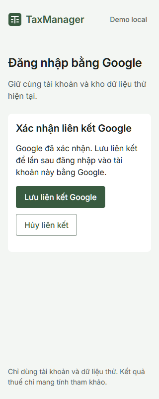
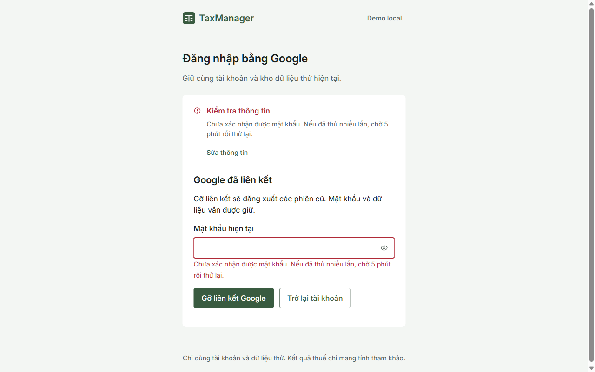
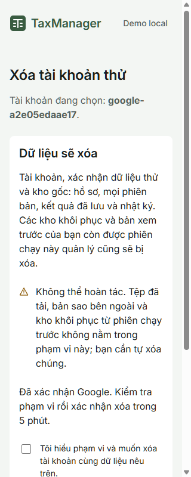

# Đ6g — liên kết và đăng nhập Google

29/11/2026. Đợt Google trong yêu cầu bổ sung SSO và khôi phục tài khoản; phạm vi local synthetic. Đây là kết quả triển khai và kiểm trong phiên, không phải review bảo mật độc lập hoặc nghiệm thu Google thực tế. Email khôi phục, passkey và mã dự phòng còn là đợt tiếp theo.

## Kết quả

- Google chỉ xuất hiện khi cấu hình opt-in hợp lệ. Dùng package Google handler 10.0.15 cùng phiên bản Identity hiện có, state/correlation/PKCE của framework, không tự xác thực OAuth token. Chỉ xin openid và map sub, không thu email/profile, không lưu token.
- Tài khoản local chọn Google và lưu liên kết trong phiên đang mở, không hỏi lại mật khẩu. Intent ghim user ID trong external ticket; có bước tiếp tục cùng origin cho cookie Strict. Google mới tạo tài khoản không mật khẩu sau khi xác nhận dữ liệu thử, user/link/acceptance trong cùng transaction; không ghép theo email/tên. Google đã biết mở đúng tài khoản và kho cũ, vẫn kiểm lockout.
- Khởi tạo/link/remove là POST có CSRF. External cookie Secure/HttpOnly/Lax, hạn 5 phút; cookie ứng dụng giữ Strict và hạn cố định 30 phút. Gỡ Google khỏi tài khoản có mật khẩu kiểm lại mật khẩu, thu hồi phiên cũ rồi đăng xuất. Google-only không được gỡ cách đăng nhập duy nhất.
- Xuất/xóa của tài khoản có mật khẩu giữ xác nhận mật khẩu. Google-only dùng vòng xác nhận Google mới, ghim đúng user/provider/sub và mục đích export/delete, hạn 5 phút từ lúc khởi tạo. Nonce phía server được tiêu thụ trước thao tác để từ chối cả cookie được lưu và gửi lại; state tạm này không qua lần khởi động host mới. Bước OAuth không tải/xóa dữ liệu. Xóa cần checkbox riêng, lỗi xóa phải xác nhận lại để tiếp tục.
- Thông báo dữ liệu thử chuyển v4, giữ claim cũ và yêu cầu xác nhận mới trước route dữ liệu. Export thêm provider/subject của chủ vào allowlist; không token hoặc credential. Không sửa schema/migration thuế hoặc registry.
- Giữ palette, typography, bố cục tài khoản và nút mắt hiện có. Không triển khai bản redesign đang chờ duyệt. Login có một nút Google phụ; mỗi màn quản lý có một primary, không divider/dropdown hoặc panel lồng. Liên kết không có ô mật khẩu; màn gỡ local vẫn có. Lỗi intent hoặc lỗi kho của Google-only nhắm đúng nút đang hiển thị, không trỏ đến ô mật khẩu không tồn tại.

Contract và cách cấu hình local: `docs/design/account-sign-in-options.md`. OAuth client thực tế và Client Secret của chủ dự án chưa có; không bật provider giả trong bản người dùng đang mở, không gửi email và không thay trust store.

## Kiểm chứng chức năng

`GoogleSignInHttpTests`: 21 ca qua HTTPS và handler OAuth thật, chỉ thay token/userinfo backchannel bằng phản hồi synthetic. Kiểm disabled/thiếu cấu hình, POST/CSRF/scope/PKCE, state/correlation, provider hủy không echo lỗi upstream; không ghép theo email; liên kết không mật khẩu nhưng phải có phiên/ticket đúng chủ, intent thiếu/hết hạn, Google thuộc chủ khác, hủy; gỡ cần mật khẩu và thu hồi phiên; lockout; ID/kho qua host mới. Google-only kiểm consent/CSRF, không lưu password/email, rollback cả user/link khi ghi consent lỗi, không gỡ credential duy nhất; proof xuất/xóa đúng chủ/mục đích/hạn, không replay cookie đã lưu; checkbox xóa; xóa cả UserLogins; lỗi kho không trả tệp hoặc tự tạo lại khóa và error action có đích thật. Log `%TEMP%/taxmanager-google-test.log`.

Test đổi chủ thay đúng cookie ứng dụng và giữ external ticket cũ để kiểm binding. Test replay khôi phục cookie external đã lưu trước khi xuất thành công, không chỉ dựa vào xóa cookie trên browser.

Fixture giữ chứng chỉ HTTPS nhập lại PFX và chỉ tin đúng thumbprint theo [k:01M8GPVC77K0TX3XN7WDF4SDJ6]. Test host mới dùng lại cùng synthetic root/registry, không tạo root thay thế theo [k:01M8CBFTQHZAEP0A2M9H7GWSHN].

## Kiểm giao diện

16 trạng thái × 320/1280 = 32 lượt Orca: login, tài khoản, chọn Google, bước tiếp tục, liên kết không mật khẩu, sai mật khẩu khi gỡ, đã liên kết, lỗi provider; Google mới, chưa đồng ý dữ liệu thử, Google là credential duy nhất, xuất trước/sau xác nhận, xóa trước/sau xác nhận, lỗi kho khi xuất Google-only. HTML lấy từ hai host HTTPS/kho mới synthetic, tách host để giữ nguyên rate limit sản phẩm; OAuth chỉ dùng backchannel giả. QA lỗi kho xóa đúng key fixture của chính nó sau khi tạo proof, không trả tệp; không gửi xóa thành công. Mirror HTTP vô hiệu hóa submit, dùng CSS/JS thật; không coi mirror là vòng OAuth trong trình duyệt.

32 lượt đều có một primary, không overflow; axe WCAG 2 A/AA, 2.1 AA, 2.2 AA có 0 violations và 0 incomplete. Kết quả máy lưu ở `2026-11-29-google-ux-checks.json`. Đã xem ảnh liên kết không mật khẩu 320, lỗi gỡ 1280, xác nhận xóa bằng Google 320. Không thay nghiệm thu trình đọc màn hình, password manager thật, native focus/zoom hoặc Google trên trình duyệt ngoài. Orca webview không dùng để đăng nhập Google thực tế.

## Cổng dự án

`bint test affected --run` không chạy do bgraph nới full vì các ảnh/audit ngoài project chưa ánh xạ, trong khi `eval.test_command` thiếu. Đã đọc `selection.widening` (42 mục ở lượt cuối), giữ nguyên dữ liệu/ảnh của các phiên khác và chạy `scripts/dev/verify-web-mvp.ps1` đầy đủ theo [k:01M8F671GP7FD4E6G4CVEW6E7R]. Script thoát 0: Core 209 + Data 332 + Web 230 = **771 test**, không skip; EF không có pending model changes. Log `%TEMP%/taxmanager-google-full.log`; `git diff --check` qua. Hai warning xUnit2031 đã có ở `ForecastPersistenceBlackBoxTests.cs` 241/243 xuất hiện khi build test hẹp, không sửa trong phạm vi này.

Đã ghi mục tri thức `01M8HPC4WHNGZ9KYEJAFWM5CEW` về allowlist claim Google, ở trạng thái candidate/origin agent chờ duyệt; không publish AGENTS hoặc tự approve. Không stage/commit hoặc thay các preview/kho người dùng đang mở.
